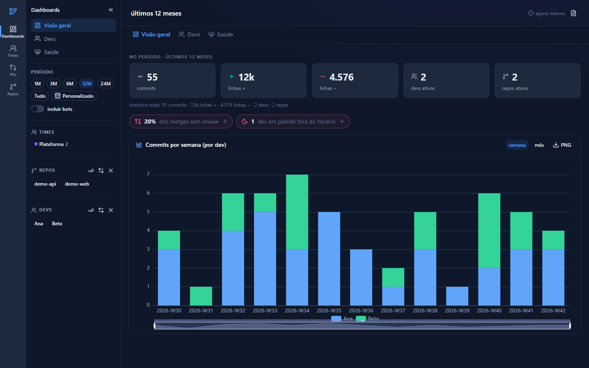

# gitview

[](https://github.com/Enlighten-Brasil/gitview/actions/workflows/ci.yml)

**English:** [README.md](README.md)

Dashboard interno de métricas do time: commits, PRs e releases dos repositórios da org, tudo local e read-only sobre os repos. Licença MIT.

**Demo ao vivo** (apenas dados sintéticos — nenhum dado real do time): https://enlighten-brasil.github.io/gitview/



## Estado do projeto

O pipeline completo funciona de ponta a ponta: os coletores rodam `git log` para dentro de um SQLite e exportam JSON em `public/data/`, PRs e reviews vêm da API do GitHub, releases combinam as tags `git tag` locais com a API, e o frontend é um build 100% estático que publica em qualquer host estático — a demo ao vivo acima é exatamente esse build. O CI roda os gates em todo PR (`pnpm check:scrub`, `pnpm lint`, `pnpm typecheck`, `pnpm build`), e toda release sai com changeset e um commit único `chore(release)` (histórico no [CHANGELOG.md](CHANGELOG.md)). O que vem a seguir vive nas issues e milestones do GitHub — ver [ROADMAP.md](ROADMAP.md); como ajudar está no [CONTRIBUTING.pt-BR.md](CONTRIBUTING.pt-BR.md).

## Setup

Requisitos:

- **Node 22.13+** (os coletores usam `node:sqlite`, sem flag desde a 22.13; o CI roda Node 22)
- **pnpm 11.28** (pinado no campo `packageManager` — `corepack enable` uma vez, ou instale o pnpm 11.28 direto)
- Uma conta GitHub — autenticada pela própria UI (**device flow** ou colando um **PAT**), ou via **GitHub CLI** (`gh auth login`), que serve de ponte quando não há token no `.env`

```bash
git clone git@github.com:Enlighten-Brasil/gitview.git
cd gitview
pnpm install
pnpm dev       # ou pnpm start — http://localhost:5173 — na primeira execução cai no assistente /setup
```

Nada para copiar ou editar antes de rodar: o `.env` é criado automaticamente a partir do `.env.example` na primeira execução (`pnpm dev`, `pnpm start` ou qualquer coletor).

### O `.env` (config da máquina — gitignored)

| chave | para quê |
|---|---|
| `GITVIEW_GITHUB_CLIENT_ID` | Client ID (público) do OAuth/GitHub App com device flow — vem preenchido no `.env.example`; vazio desliga o botão "Conectar com GitHub" |
| `GITVIEW_GITHUB_TOKEN` | token gravado pelo device flow/PAT. **É o único segredo do projeto** — vazio usa o `gh auth token` se o gh estiver logado |
| `GITVIEW_GITHUB_ORG` | org default do setup e da importação de times em /team |
| `GITVIEW_REPOS_ROOT` | pasta com os clones. Vazio = `data/repos` (criado pelo setup) |
| `GITVIEW_DEFAULT_REPOS` | CSV de repos pré-selecionados no setup (vazio = todos não arquivados) |
| `GITVIEW_EXCLUDE` | CSV de pastas ignoradas na descoberta de repos |
| `GITVIEW_EXCLUDE_PATHS` | CSV de globs de arquivos gerados ignorados nas métricas de linhas (acrescenta à lista padrão de lockfiles/minificados). Só vale para commits novos — histórico: `pnpm clean && pnpm collect` |
| `GITVIEW_PORT` | porta do dev server (default 5173) |
| `GITVIEW_TIMEZONE` | fuso IANA de todos os buckets de tempo (dia/mês/semana ISO/fim de semana/madrugada/heatmap) — os agregados independem do relógio da máquina que coleta. Default: `America/Sao_Paulo` |

Ordem de precedência: variável do shell → `.env` → default. O arquivo é lido **fresco** a cada execução de coletor (token novo vale sem reiniciar o dev server). Caminhos em Windows: use barra normal (`C:/dev/repos/api`), ou aspas simples se houver espaços.

> ⚠ **Pull para o time**: quem ainda tem `config.json`/`config.local.json` (formato antigo) e ainda não rodou nada deste release, rode `pnpm dev` **antes** de dar pull — a migração move tudo para `.env` + `team.local.json` (os aliases do `config.json` versionado vivem desde então no `team.local.json` de cada máquina; `pnpm clean` não apaga esse arquivo).

### Config do time (`team.local.json` — gitignored)

Perfis de devs (título, descrição), aliases (e-mails de commit, logins do GitHub), times e bots extras. Tudo editável pela tela **/teams** (dev only; persistido via `/__team/config`). Salvar regenera o `team.json` na hora — nomes/cores/membros dos times aparecem imediatamente nos chips da sidebar e nos dashboards `/teams/<nome>`; aliases de identidade ainda pedem recoleta (eles reescrevem o `stats.json`). É a única fonte de nomes canônicos — sem ela o dashboard funciona, cada e-mail/login vira um autor separado e a coleta lista os "candidatos" pra você ir associando.

Cada time também ganha um dashboard compartilhável em **`/teams/<nome>`** — KPIs, timeline de commits, PRs e fora-do-horário com os devs travados nos membros (período e repos continuam filtráveis). Renomear um time não quebra links antigos: os nomes anteriores ficam em `renamedFrom` e `/teams/<nome-antigo>` redireciona pro atual.

### Setup pela UI (`/setup`)

Na primeira execução (sem dados coletados) o dashboard redireciona para o assistente de 3 passos + 1 opcional (`/setup/github` → `/setup/repos` → `/setup/collect` → `/setup/team`) — também acessível depois pelo item **Config** da rail lateral (⚙, só em dev; com dados ele abre direto as **Configurações** `/settings`):

1. **Conectar o GitHub** — device flow (o browser abre `github.com/login/device`, você digita o código; o token vai para o seu `.env`), colar um **PAT** (repo + read:org) ou a ponte do `gh auth login`. Com Client ID configurado o botão aparece; sem ele, os outros caminhos funcionam.
2. **Escolher repositórios** — lista os repos da sua org (ou da sua conta pessoal), com busca e pré-seleção do `GITVIEW_DEFAULT_REPOS`.
3. **Clonar e coletar** — faz clones bare em `data/repos/` e roda a primeira coleta com progresso ao vivo.
4. **(Opcional) Definir o time** — aparece só quando a primeira coleta achou identidades sem mapeamento (autores de git/logins do GitHub ainda não ligados a um dev) e leva direto ao editor em `/teams#sem-mapeamento`; sem candidatos, o assistente vai direto ao dashboard.

Os clones de `data/repos/` são atualizados automaticamente via `git fetch` a cada coleta (o token é injetado por variável de ambiente do git, nunca gravado no clone). Não é necessário ter os repos clonados em lugar nenhum, nem o `gh` instalado.

### Setup pelo terminal (alternativa)

`pnpm setup` faz o mesmo fluxo de clone no terminal (usa o token da config — que pode vir do `gh`). Útil para automação.

### Apontar para clones existentes

Se você já tem os repos clonados e prefere usá-los, o coletor procura a pasta na ordem:

1. Variável de ambiente `GITVIEW_REPOS_ROOT`
2. `GITVIEW_REPOS_ROOT` no `.env`
3. Padrão: `data/repos` (clones gerenciados do setup)

Nesse modo os dados refletem o estado do seu clone local — dê `git pull` nos repos antes de coletar se quiser dados frescos.

### Usando com outro time/org

O projeto não tem dado de máquina nem de time versionado: `.env` e `team.local.json` são gitignored e criados por cada um (o `.env.example` é o único template, com um Client ID de exemplo). Ajustes típicos:

- `GITVIEW_GITHUB_ORG` / `GITVIEW_DEFAULT_REPOS` — org e pré-seleção do setup
- `GITVIEW_GITHUB_CLIENT_ID` — Client ID de um **GitHub App** (recomendado, começa com `Iv…`) ou **OAuth App** (`Ov…`) seu/da sua org com **Device Flow habilitado** (GitHub → Settings → Developer settings). Nunca coloque client secret — o device flow não usa secret.

> **Read-only de verdade**: use um **GitHub App** com permissão *Repository → Contents: Read-only* (+ *Metadata*, automática) instalado na org — o token emitido é fisicamente incapaz de escrever. OAuth App e `gh auth login` usam o escopo `repo`, que é read+write: o gitview só faz leituras, e os clones gerenciados têm a URL de push travada (`remote.origin.pushurl=no-push`), mas a garantia de permissão real vem do GitHub App.

### Limpar e recomeçar

Banco e JSONs são 100% regeneráveis a partir dos repositórios (`team.local.json` **não** é — é o cadastro do time):

- **UI**: **Config → Geral** (`/settings`) → card "Manutenção dos dados locais" → *recoletar tudo* (re-scan completo), *limpar e recoletar* (apaga banco + JSONs e recoleta; clones mantidos) ou *apagar dados* (apaga sem recoletar — volta ao assistente /setup).
- **CLI**: `pnpm clean` (apaga `data/gitview.db*` + `public/data/*.json`) e depois `pnpm collect`. `pnpm clean -- --repos` apaga também os clones (a próxima coleta re-clona tudo — lento).

## Comandos

```bash
pnpm dev / start        # dashboard em http://localhost:5173 (navbar: ↻ recoleta; o item Config ⚙ da rail abre as Configurações — sem dados, cai no assistente /setup)
pnpm setup              # wizard de terminal: escolher/clonar repos da org
pnpm collect            # os 4 coletores em sequência + validação (incremental)
pnpm collect:github     # só PRs/reviews
pnpm collect:releases   # só releases
pnpm check:data         # validação de shape dos JSONs gerados
pnpm check:scrub        # gate anti-regressão: arquivo tracked não traz de volta termos de identidade (também no CI)
pnpm clean              # apaga banco + JSONs (regeneráveis; --repos inclui os clones)
pnpm build              # build estático (dist/ — somente leitura, sem endpoints de setup)
pnpm changeset          # registrar mudança
pnpm version:packages   # aplicar changesets (bump + CHANGELOG)
```

## Publicar o dashboard (build estático)

O frontend só lê os JSON de `public/data/` — `pnpm build` gera um `dist/` 100% estático, sem servidor próprio. O fluxo de publicação:

1. Na máquina com token e clones: atualize os dados (`pnpm collect`, ou o ↻ da navbar em `pnpm dev`) e rode `pnpm build`.
2. Publique `dist/` em qualquer servidor estático (GitHub Pages, Netlify, nginx…). Precisa de **fallback de SPA**: deep links como `/devs/<nome>` devem servir o `index.html` (o router usa `createWebHistory`).
3. Dados frescos = repetir 1–2 de tempos em tempos (um cron/CI com o token serve).

**No build estático o dashboard é somente leitura**: `/setup`, `/settings` e a coleta (↻) não existem, e a edição do `/teams` fica desabilitada — os endpoints `/__*` são middleware do dev server (detalhes em `CONTRIBUTING.pt-BR.md`). Unifique identidades e ajuste times no dev, recolete e só então publique.

## Convenções

- Toda mudança = changeset (`minor` feature / `patch` fix) → `pnpm version:packages` → commit único `chore(release): X.Y.Z`.
- Commits em pt-BR (Conventional Commits), código em inglês, comentários em pt-BR.
- `data/` (banco + clones), `public/data/`, `.env` e `team.local.json` são locais e gitignored.
- Detalhes de arquitetura e regras de filtro: ver `AGENTS.md`.
- Guia de contribuição (setup, gates, ritual de release): `CONTRIBUTING.pt-BR.md` — versão em inglês: `CONTRIBUTING.md`.
